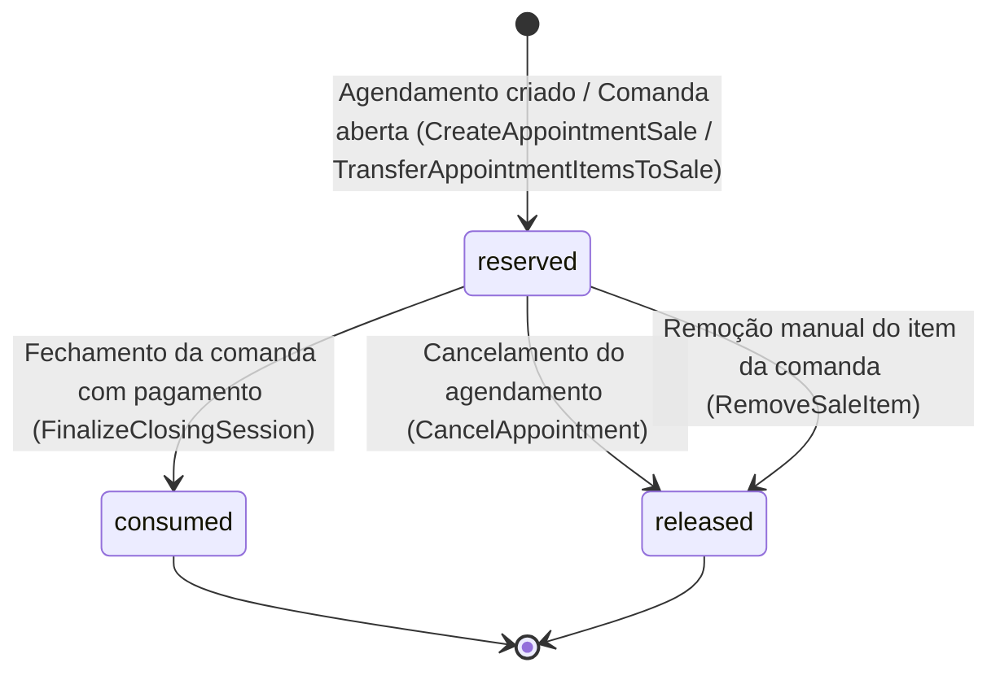

# Cobertura de Pacotes no Agendamento

## 1. Contexto e Objetivo

Antes desta implementação, os pacotes adquiridos por clientes eram gerenciados de forma isolada no módulo de marketing/comandas. Ao realizar um agendamento (seja via painel interno da Agenda ou através do fluxo de Online Booking), o sistema criava comandas vinculadas ao agendamento cobrando o valor nominal integral de cada serviço. O operador ou caixa precisava intervir manualmente para deduzir sessões de pacote ou zerar itens na comanda, gerando atritos operacionais, risco de cobrança indevida e falta de rastreabilidade de consumo.

Com a arquitetura de **Cobertura de Pacotes no Agendamento**:
- O agendamento interno e o agendamento público (online booking) identificam automaticamente se o cliente possui pacotes ativos com saldo para os serviços selecionados.
- Ao abrir ou sincronizar a comanda vinculada ao agendamento (`Sale`), os serviços cobertos têm seu valor lançado como **R$ 0,00** (`unit_price_cents = 0` e `total_cents = 0`).
- É criada simultaneamente uma reserva formal de sessão (`PackageUsageReservation`) com status `reserved`, protegendo o saldo do pacote contra *overbooking* ou uso duplicado simultâneo.
- O fechamento da comanda no caixa consome efetivamente a reserva (`consumed`), enquanto cancelamentos liberam a sessão de volta ao saldo disponível (`released`).

---

## 2. Arquitetura e Fluxo de Dados

### 2.1 Resolução de Cobertura via `ResolveCustomerPackageCoverage`

A classe de serviço `App\Actions\Appointments\ResolveCustomerPackageCoverage` encapsula as regras de negócio para determinar se um serviço agendado é elegível para abatimento via pacote.

#### Critérios de Elegibilidade e Priorização:
1. **Status e Validade**: O `CustomerPackage` deve pertencer ao mesmo tenant/unit, estar com status `active` e com validade não expirada (`expires_at IS NULL` ou `expires_at >= today`).
2. **Priorização FEFO (*First Expiring, First Out*)**: Ordenação estrita por `ORDER BY expires_at IS NULL, expires_at ASC`, garantindo que pacotes próximos ao vencimento sejam consumidos antes de pacotes de vigência mais longa.
3. **Comprovação de Pagamento Estrita**: Integração com `LegacyPackageReconciliation::hasStrictPaidSaleEvidence()`. O pacote só concede cobertura se a comanda de origem estiver quitada (`paid`) ou se houver obrigações financeiras regularizadas sem pendências/estornos. Pacotes não pagos não geram reservas.
4. **Saldo Global e Saldo por Serviço**:
   - O saldo global do pacote (`remaining_sessions`) deve ser superior a zero e superar as reservas ativas.
   - O saldo específico do serviço no balanço (`CustomerPackageService::remaining_quantity`) deve ser suficiente.
5. **Dedução de Reservas Ativas**:
   - Saldo líquido disponível do serviço = `remaining_quantity - sum(sessions_reserved com status 'reserved') - alocações_em_memória`.
   - Saldo líquido do pacote = `remaining_sessions - sum(sessions_reserved com status 'reserved') - alocações_em_memória`.
6. **Múltiplos Serviços no Mesmo Agendamento**:
   - O método `resolve(...)` recebe um array referenciado `&$allocatedCounts`. Quando um agendamento possui 2 ou mais serviços cobertos pelo mesmo pacote, cada resolução incrementa a alocação em memória, prevenindo que dois itens consumam a mesma sessão disponível.

### 2.2 Ciclo de Vida da Reserva (`PackageUsageReservation`)

A entidade `PackageUsageReservation` rastreia o ciclo de vida completo do abatimento:



- **`reserved`**: Criada na abertura ou sincronização da comanda do agendamento. Aponta para `customer_package_id`, `service_id`, `sale_item_id`, `tenant_id`, `unit_id` e registra `sessions_reserved = 1`.
- **`consumed`**: No fechamento da comanda (`FinalizeClosingSession`), as reservas com status `reserved` associadas aos itens da venda são convertidas para `consumed`, acompanhadas do registro definitivo em `PackageUsage` e mutação no balanço do pacote (`MutateCustomerPackageBalance`).
- **`released`**: Se o agendamento for cancelado (`CancelAppointment`), ou se o item for removido da comanda (`RemoveSaleItem`), a reserva é transitada para `released`, restaurando imediatamente a disponibilidade da sessão sem necessidade de estornos financeiros.

### 2.3 Integração com Pipelines de Venda e Sincronização

A resolução de pacotes atua em três pontos centrais da esteira de agendamento e faturamento:

1. **`CreateAppointmentSale`**:
   - Invocado quando uma comanda é gerada para um agendamento novo.
   - Avalia cada serviço do agendamento com `ResolveCustomerPackageCoverage`.
   - Se coberto, define `unit_price_cents = 0`, anota `customer_package_id` no `SaleItem` e cria o registro `PackageUsageReservation(status: 'reserved')`.

2. **`TransferAppointmentItemsToSale`**:
   - Utilizado ao associar um agendamento a uma comanda aberta já existente.
   - Aplica a mesma lógica de resolução e reserva de sessões para os novos itens injetados.

3. **`SynchronizeAppointmentSale`**:
   - Mantém paridade quando itens ou serviços do agendamento são adicionados, alterados ou removidos na agenda.
   - Ajusta os itens da comanda e preserva ou recompõe as reservas ativas conforme a elegibilidade dos serviços atualizados.

---

## 3. Endpoint de Pacotes Ativos (`GET /customers/{customer}/active-packages`)

### 3.1 Propósito
Fornece à interface da Agenda (e telas correlatas) a fotografia em tempo real dos pacotes disponíveis para o cliente selecionado, calculando saldos brutos, reservas pendentes e saldo líquido disponível por serviço.

### 3.2 Rota e Autenticação
- **URI**: `/customers/{customer}/active-packages`
- **Nome da Rota**: `customers.active_packages`
- **Middleware**: `auth:sanctum`, `verified`, controle multi-tenant e verificação de autorização `viewAny` em `CustomerPackage`.

### 3.3 Exemplo de Resposta JSON
```json
{
  "data": [
    {
      "id": "019460d3-3b1a-7b3b-9a41-3b7c02c61142",
      "name": "Combo Barba & Cabelo (5 Sessões)",
      "total_sessions": 5,
      "remaining_sessions": 4,
      "reserved_sessions": 1,
      "available_sessions": 3,
      "expires_at": "2026-12-31",
      "services": [
        {
          "service_id": "019460d3-3b1a-7b3b-9a41-3b7c02c61150",
          "service_name": "Corte de Cabelo",
          "remaining_quantity": 2,
          "reserved_quantity": 1,
          "available_quantity": 1
        },
        {
          "service_id": "019460d3-3b1a-7b3b-9a41-3b7c02c61155",
          "service_name": "Barba Terapia",
          "remaining_quantity": 2,
          "reserved_quantity": 0,
          "available_quantity": 2
        }
      ]
    }
  ]
}
```

---

## 4. Experiência do Operador na Agenda

No frontend em React/Inertia (`resources/js/pages/calendar/index.tsx`), a experiência foi desenhada para dar total transparência ao operador sem impor cliques adicionais:

### 4.1 Carregamento Reativo no Formulário (`AppointmentForm`)
- Sempre que um cliente é selecionado no drawer de agendamento (`selectedCustomer`), o formulário dispara requisição assíncrona ao endpoint `active_packages`.
- Uma simulação local de alocação em memória cruza os serviços marcados (`selectedServices`) com os saldos disponíveis (`available_quantity`), espelhando rigorosamente a regra do backend.

### 4.2 Indicadores Visuais e Badges de Cobertura
- **No Seletor de Serviços**: Cada item da lista de serviços exibe badges dinâmicos:
  - `Badge variant="secondary"` com ícone `PackageCheck`: *"Coberto por pacote (R$ 0,00)"*.
  - Indicação do nome do pacote que proverá o benefício.
- **No Resumo de Valores (`AppointmentSummaryHeader`)**:
  - Exibe o valor original riscado e destaca o total a cobrar como **R$ 0,00** para serviços cobertos.
  - Alerta em destaque informando: *"Coberto por pacote - R$ 0,00 na comanda"*.
- **Comandas Vinculadas**: Na visualização da comanda e painel de pagamento, itens de pacote possuem a flag e badge identificador de abatimento via pacote ativo.

---

## 5. Testes e Garantia de Qualidade

A integridade do fluxo é assegurada por testes de ponta a ponta com Pest PHP:

### 5.1 Suítes Automatizadas
1. **`tests/Feature/AppointmentSalePackageCoverageTest.php`** (12 testes):
   - `covers internal appointment with zero value when package active`: Valida criação de agendamento interno, comanda gerada com R$ 0,00 e reserva com status `reserved`.
   - `covers online public booking with zero value when client has active package`: Valida o fluxo de booking online público aplicando cobertura com saldo reservado.
   - `allocates multiple services across packages or multiple sessions correctly`: Garante a alocação de múltiplos serviços no mesmo agendamento sem colisão de saldo.
   - `does not cover service when package has zero remaining sessions`: Assegura que pacotes esgotados cobram o valor de tabela normal.
   - `releases reservation when appointment is cancelled`: Confirma a transição da reserva de `reserved` para `released` ao cancelar agendamento.
   - `converts reservation to consumed when sale is finalized`: Testa o ciclo de encerramento do caixa consumindo a sessão e registrando a baixa.
   - `does not cover service when package sale is unpaid`: Valida a trava estrita contra pacotes sem confirmação de pagamento.
   - `prioritizes package expiring sooner (FEFO)`: Garante que o pacote com vencimento mais próximo é priorizado.

2. **`tests/Feature/CustomerActivePackagesEndpointTest.php`** (5 testes):
   - Validação do payload retornado pelo endpoint `GET /customers/{customer}/active-packages`, descontando reservas ativas de `available_quantity` e `available_sessions`.
   - Ocultação de pacotes sem evidência estrita de quitação ou vencidos.

3. **`tests/Feature/CustomerPackageBalanceAuditCommandTest.php`** (3 testes):
   - Comandos de auditoria e consistência de balanço de sessões.

### 5.2 Execução Rápida dos Testes
```bash
php artisan test --compact tests/Feature/AppointmentSalePackageCoverageTest.php tests/Feature/CustomerActivePackagesEndpointTest.php
```
Todas as suítes rodam com 100% de sucesso (20 testes, 130 asserções).
